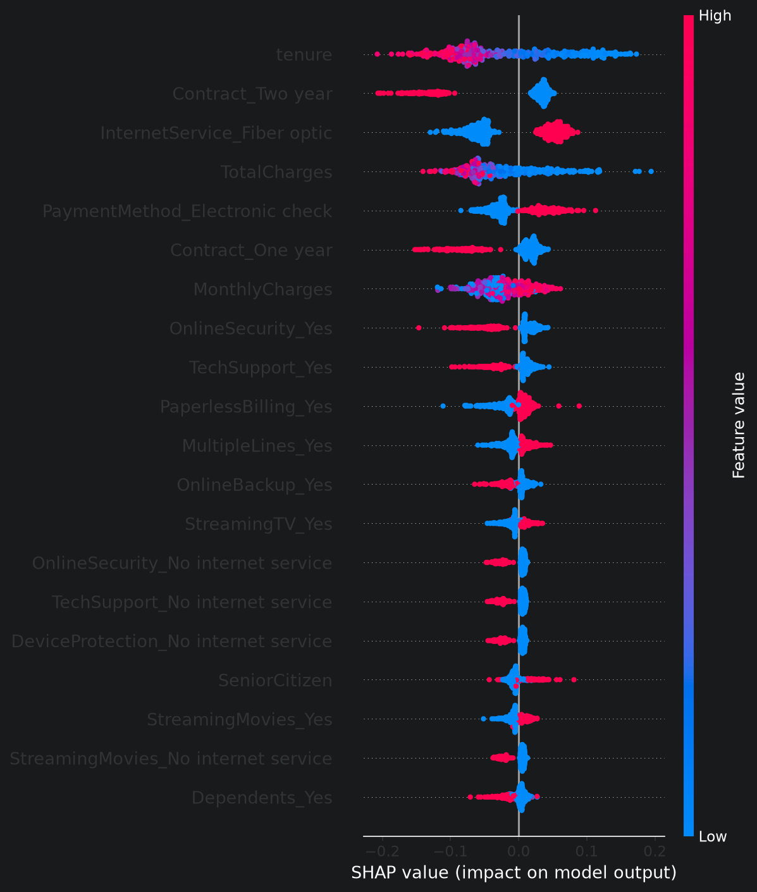
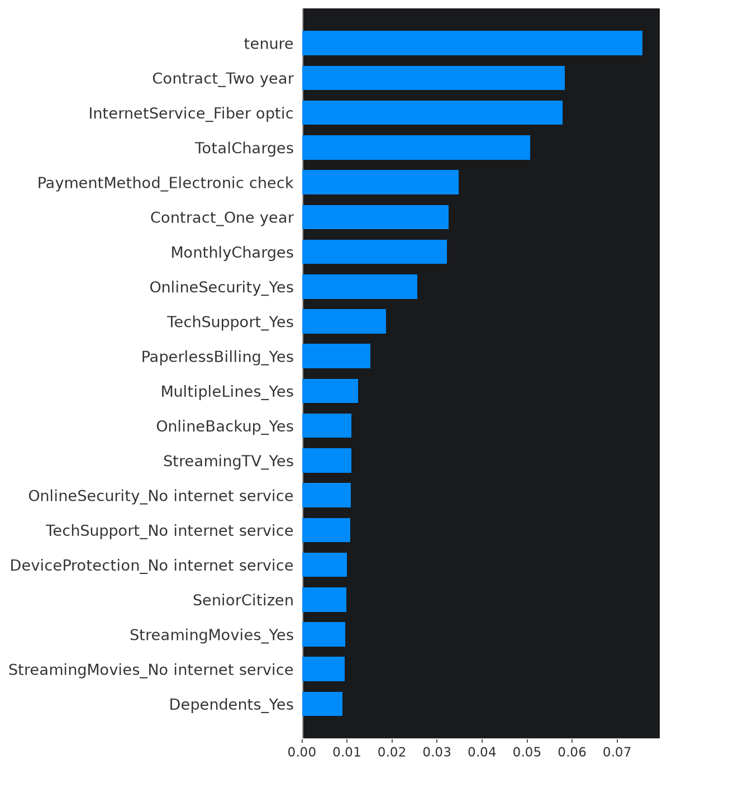
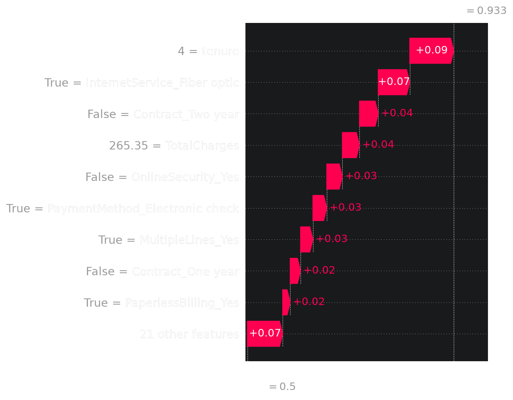
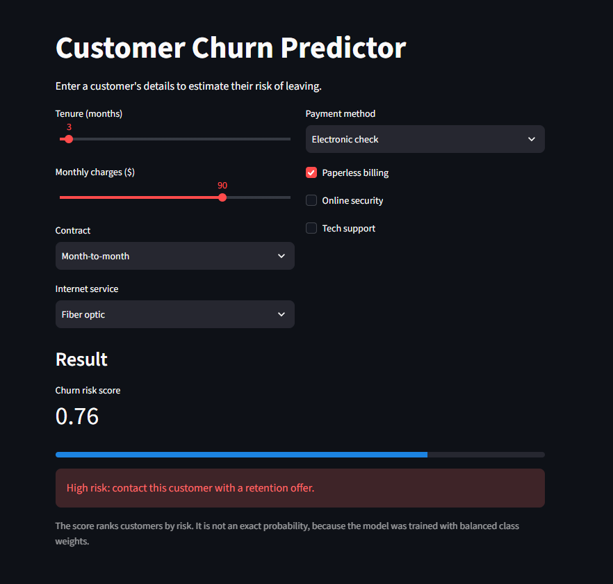
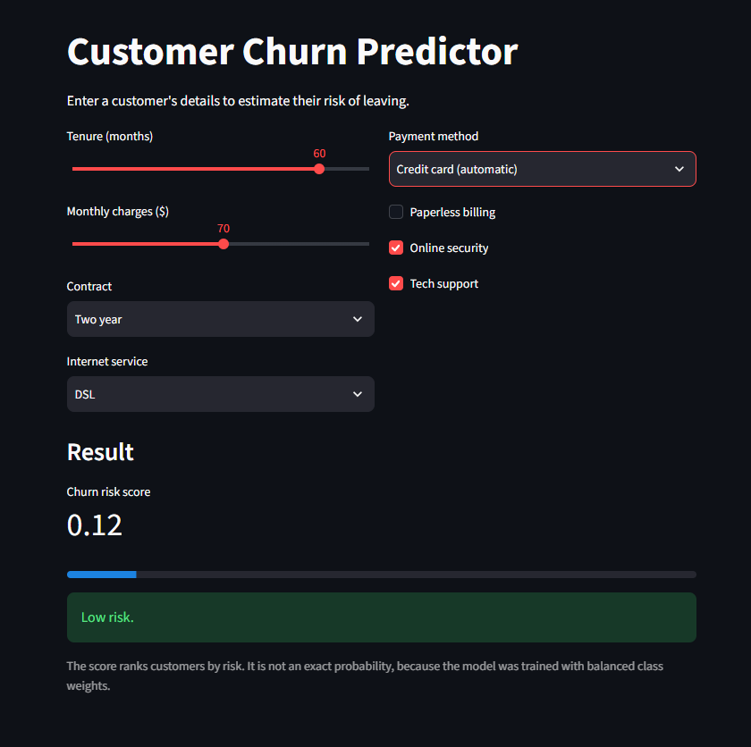

# Customer Churn Prediction with Explainable AI

An end-to-end machine learning project that predicts which telecom customers are likely to leave, explains why using SHAP, and serves the predictions in a small Streamlit app.

## Business problem

Acquiring a new customer costs far more than keeping an existing one. If a company can identify customers at risk of leaving, it can contact them first with a retention offer. This project builds a model that ranks customers by churn risk and explains the main reasons behind each score.

## Dataset

[Telco Customer Churn](https://www.kaggle.com/datasets/blastchar/telco-customer-churn) from Kaggle: about 7,000 customers and 21 columns (contract type, tenure, internet service, charges, payment method and more). About 27% of customers churned, so the data is imbalanced.

## Approach

1. **Cleaning and exploration:** fixed blank `TotalCharges` values, removed the ID column, and explored churn by contract, tenure, charges and internet service.
2. **Modeling:** compared a Logistic Regression baseline with a Random Forest (balanced class weights) on an 80/20 stratified split.
3. **Evaluation:** used ROC-AUC and churn recall instead of accuracy, because a model that always predicts "no churn" would be about 73% accurate and useless.
4. **Explainability:** used SHAP to show which factors drive the risk, globally and for individual customers.
5. **App:** built a Streamlit app to score a customer from their details.

## Results

| Model | ROC-AUC | Churn recall | Churn precision | Churn F1 | Accuracy |
|---|---|---|---|---|---|
| Logistic Regression | 0.836 | 0.57 | 0.65 | 0.61 | 0.80 |
| Random Forest | 0.821 | 0.66 | 0.56 | 0.61 | 0.77 |

Logistic Regression has the higher ROC-AUC and precision. I chose the Random Forest as the final model because it catches more real churners (recall 0.66 vs 0.57), which matters most when missing a leaving customer costs more than sending an unnecessary offer. It also works directly with SHAP's TreeExplainer.

## Key insights

- **Tenure is the strongest driver.** New customers are at much higher risk.
- **Contract type matters a lot.** One- and two-year contracts strongly lower the risk compared with month-to-month.
- **Fiber optic customers have a higher risk**, which may point to price or service-quality problems.
- Customers with **online security or tech support** have a lower risk, and those paying by **electronic check** a higher one.

### SHAP: what drives churn





### Explaining one customer



## Business recommendations

1. Target new month-to-month customers first, with an offer to move to a longer contract.
2. Strengthen onboarding during the first year.
3. Investigate the fiber optic customer experience.
4. Offer online security and tech support free for the first months.
5. Encourage automatic payment for electronic check payers.
6. Use the model as a weekly watch list of the highest-risk customers, with the SHAP reasons for each.

SHAP shows associations in the data, not proven causes, so any offer should be tested (for example with an A/B test) before a wide rollout.

## App demo

**High-risk customer** (new, month-to-month, fiber optic, electronic check):



**Low-risk customer** (long tenure, two-year contract, DSL, automatic payment):



The score ranks customers by risk. It is not an exact probability, because the model was trained with balanced class weights.

## Limitations and next steps

- The app uses 8 of the model's inputs and sets the others to 0.
- Both models use the default 0.5 threshold; a company would choose it based on the cost of an offer versus the value of a retained customer.
- Possible improvements: hyperparameter tuning, probability calibration, and deploying the app online.

## How to run

```
git clone https://github.com/YOUR-USERNAME/churn-prediction.git
cd churn-prediction
python -m venv .venv
.venv\Scripts\activate
pip install -r requirements.txt
streamlit run app.py
```

To re-run the analysis, open `notebooks/analysis.ipynb`.

## Tech stack

Python, pandas, scikit-learn, SHAP, matplotlib, seaborn, Streamlit, joblib